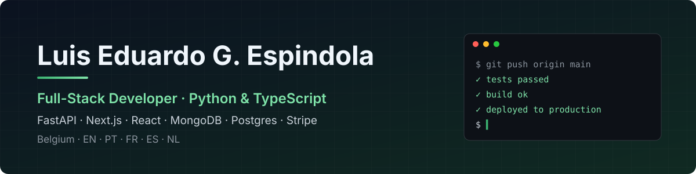

   

## 👋 About me

I'm a **full-stack developer** who builds products end to end: the API, the data model, the UI, the payments and the deployment. My daily stack is **Python / FastAPI** on the back end and **TypeScript / React / Next.js** on the front end, with MongoDB or Postgres underneath and Stripe wherever money changes hands.

- 🏠 I'm the lead developer of **[House Hunter](https://househunter.immo)**, a real-estate aggregator for the Belgian market, from the scrapers to the billing (2,200+ commits).
- 🧪 I care about evidence: tests, evaluation harnesses, and numbers before claims (see [rag-docs-assistant](https://github.com/LuisEduardoGE/rag-docs-assistant)).
- 🤖 I use AI coding tools every day, with the engineering discipline to keep the output correct.
- 📈 **5,900+ contributions in the last 12 months**, most of them in private product and client repositories.
- 🌍 I speak English, Portuguese, French, Spanish and Dutch.

## 🚀 Products in production

| Product | What it is | Stack |
|---|---|---|
| **[House Hunter](https://househunter.immo)** | Real-estate aggregator for Belgium: scrapes 6 sources into one search, with saved-search email alerts, market history, an admin panel and Stripe subscriptions. | FastAPI · Celery · MongoDB · Next.js 16 · React 19 · Stripe |
| **[Love Mail](https://lovemail.online)** | Paid digital love letters: the sender picks a tone, adds a song and photos, pays with Stripe, and delivers by email or QR code. | React · Vite · Express · TypeScript · Stripe |
| **[W-Tech IT Solutions](https://www.wtechitsolutions.com)** | Company website: static, SEO-first Next.js site with structured data, case studies, a blog and a contact form. | Next.js · TypeScript · MongoDB |
| **[Skipy](https://skipy.online/en)** | Online storefront and skip-the-line ordering for cafés, restaurants and small shops: one link or QR code becomes a store where customers order and pay from their phone, with a manager app, an admin portal and live order updates. Runs in Belgium and Brazil. | FastAPI · MongoDB · Celery · Next.js · Expo · Stripe |
| **[HiddenBeer](https://hiddenbeer.com/)** | Geo-based "first beer free" offers at bars in Brussels: users find nearby offers on a map, sign in with a one-time code, claim a reservation and redeem it with a signed QR code scanned by the bar. Includes a bar-owner portal and an admin dashboard; runs in Belgium and Brazil. | FastAPI · MongoDB (geospatial) · Next.js 15 · Leaflet · Docker |
| **CAAB legal platform** | Custom WordPress engine for the Brazilian legal market: lawyer profiles with custom search and indexing, a classifieds engine and plugins, serving 5,000+ professional profiles. | PHP · WordPress · MySQL · JavaScript |

## 🔭 Open-source projects

- **[backrooms-game](https://github.com/LuisEduardoGE/backrooms-game)**: found-footage horror game in the browser, a procedural Backrooms level seen through a 90s camcorder. **[Play it →](https://luiseduardoge.github.io/backrooms-game/)** · Three.js, TypeScript
- **[rag-docs-assistant](https://github.com/LuisEduardoGE/rag-docs-assistant)**: question answering over the FastAPI docs with hybrid retrieval (vector + BM25, weighted RRF) and a labelled evaluation harness that measures retrieval quality. · Python, LanceDB, FastAPI
- **[fastapi-stripe-webhooks](https://github.com/LuisEduardoGE/fastapi-stripe-webhooks)**: Stripe webhooks that survive production: raw-body signature checks, idempotency by event ID, out-of-order safety and the `StripeObject.get()` pitfall that once kept a paying customer on the free plan. · FastAPI, Stripe, pytest
- **[movie-helper](https://github.com/LuisEduardoGE/movie-helper)**: group movie picker: friends join a room, vote on a TMDB deck, and pairwise and head-to-head rounds narrow it to one winner. · FastAPI, React 19, TypeScript
- **[primordial](https://github.com/LuisEduardoGE/primordial)**: artificial-life simulation where neural-network particles evolve by selection alone; PyTorch research engine plus a three.js browser viewer. · PyTorch, TypeScript
- **[marketplace-directory-template](https://github.com/LuisEduardoGE/marketplace-directory-template)**: configurable shop directory for food courts and market halls, from one config file and a CSV. **[Demo →](https://luiseduardoge.github.io/marketplace-directory-template/)** · HTML, CSS, JavaScript
- **[fastapi-vs-drf-comparison](https://github.com/LuisEduardoGE/fastapi-vs-drf-comparison)**: the same CRUD API built in FastAPI + SQLModel and in Django REST Framework, compared side by side. · Python
- **[planetjersey](https://github.com/LuisEduardoGE/planetjersey)**: football-kit storefront with catalog filters, search and a cart drawer. · React, TypeScript, Vite
- **[qr-code-creator](https://github.com/LuisEduardoGE/qr-code-creator)**: CLI that generates QR codes with a centred logo and rounded corners. · Python, Pillow
- **[bis2-scraper](https://github.com/LuisEduardoGE/bis2-scraper)**: scrape-to-dashboard pipeline: scrapers upsert into Supabase Postgres on a daily GitHub Actions schedule. · Python, Supabase

## 🛠 Skills

- **Back end:** Python, FastAPI, Flask, Celery, Node.js / Express, REST APIs, WebSockets / Socket.IO, background jobs and scheduling
- **Front end:** TypeScript, React, Next.js (App Router, SSG / SSR), Vite, Tailwind CSS, shadcn/ui, Three.js
- **Data:** MongoDB, PostgreSQL, MySQL, SQLite, Supabase, LanceDB, web scraping (requests, BeautifulSoup, Playwright)
- **Payments and integrations:** Stripe (Checkout, webhooks, subscriptions), OAuth / Google sign-in, email delivery, Firebase
- **DevOps:** Linux VPS, nginx, systemd, Docker, GitHub Actions, GitHub Pages
- **Testing:** pytest, Vitest, Playwright, evaluation harnesses for retrieval
- **AI:** retrieval-augmented generation, embeddings, LLM APIs, AI-assisted development

  

## 📊 Activity

<picture>
  <source media="(prefers-color-scheme: dark)" srcset="https://raw.githubusercontent.com/LuisEduardoGE/LuisEduardoGE/output/github-contribution-grid-snake-dark.svg">
  <source media="(prefers-color-scheme: light)" srcset="https://raw.githubusercontent.com/LuisEduardoGE/LuisEduardoGE/output/github-contribution-grid-snake.svg">
  
</picture>

<b>More stats</b> (streak, languages, activity graph)

 

<picture>
  <source media="(prefers-color-scheme: dark)" srcset="https://streak-stats.demolab.com/?user=LuisEduardoGE&theme=dark&background=0d1117&ring=3CB371&fire=3CB371&currStreakLabel=3CB371&hide_border=true">
  
</picture>

## 📫 Get in touch

Hiring for a full-stack or back-end role in the EU or remote? Building a product that needs someone to take it from idea to production? Email me at **[luisedu.ge@gmail.com](mailto:luisedu.ge@gmail.com)** or message me on **[LinkedIn](https://www.linkedin.com/in/luisgespindola/)**.

