

<a href="https://www.linkedin.com/in/luisgespindola/"><picture><source media="(prefers-color-scheme: dark)" srcset="assets/contact-linkedin-dark.svg"><source media="(prefers-color-scheme: light)" srcset="assets/contact-linkedin-light.svg"></picture></a>
<a href="mailto:luisedu.ge@gmail.com"><picture><source media="(prefers-color-scheme: dark)" srcset="assets/contact-email-dark.svg"><source media="(prefers-color-scheme: light)" srcset="assets/contact-email-light.svg"></picture></a>
<a href="https://calendly.com/luiseduardoge/30min"><picture><source media="(prefers-color-scheme: dark)" srcset="assets/contact-calendar-dark.svg"><source media="(prefers-color-scheme: light)" srcset="assets/contact-calendar-light.svg"></picture></a>
<a href="https://wtechitsolutions.com/"><picture><source media="(prefers-color-scheme: dark)" srcset="assets/contact-site-dark.svg"><source media="(prefers-color-scheme: light)" srcset="assets/contact-site-light.svg"></picture></a>
<picture><source media="(prefers-color-scheme: dark)" srcset="assets/contact-status-dark.svg"><source media="(prefers-color-scheme: light)" srcset="assets/contact-status-light.svg"></picture>

## 👋 About me

<picture><source media="(prefers-color-scheme: dark)" srcset="assets/about-pipeline-dark.svg"><source media="(prefers-color-scheme: light)" srcset="assets/about-pipeline-light.svg">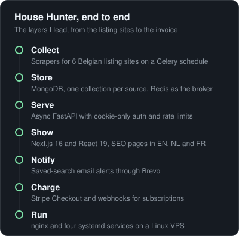</picture>

**I build web products end to end and keep them running in production.**

For 4+ years I've taken products from the first commit to paying customers: the data model, the API, the interface, Stripe billing and the server underneath. I work in **Python** (FastAPI) and **TypeScript** (React, Next.js), on MongoDB or Postgres.

I'm the lead developer of **[House Hunter](https://househunter.immo)** (2,200+ commits). It checks six Belgian listing sites every day and emails people the homes that match their search. The card shows each layer, from scraper to invoice.

Tests and numbers come before claims: every public repo below runs CI, and [rag-docs-assistant](https://github.com/LuisEduardoGE/rag-docs-assistant) measures its own retrieval quality. Most of my 5,900+ contributions last year went to private repositories, so these are the public part.

 

## 🚀 Products in production

<a href="https://househunter.immo"><picture><source media="(prefers-color-scheme: dark)" srcset="assets/card-product-househunter-dark.svg"><source media="(prefers-color-scheme: light)" srcset="assets/card-product-househunter-light.svg">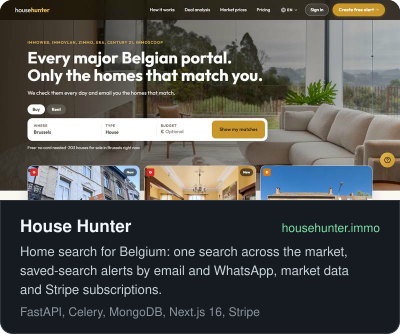</picture></a>
<a href="https://skipy.online/en"><picture><source media="(prefers-color-scheme: dark)" srcset="assets/card-product-skipy-dark.svg"><source media="(prefers-color-scheme: light)" srcset="assets/card-product-skipy-light.svg">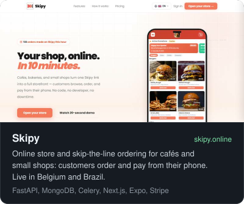</picture></a>
<a href="https://hiddenbeer.com/"><picture><source media="(prefers-color-scheme: dark)" srcset="assets/card-product-hiddenbeer-dark.svg"><source media="(prefers-color-scheme: light)" srcset="assets/card-product-hiddenbeer-light.svg">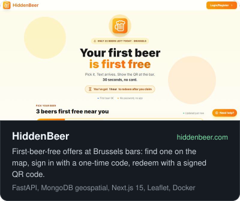</picture></a>
<a href="https://lovemail.online"><picture><source media="(prefers-color-scheme: dark)" srcset="assets/card-product-lovemail-dark.svg"><source media="(prefers-color-scheme: light)" srcset="assets/card-product-lovemail-light.svg">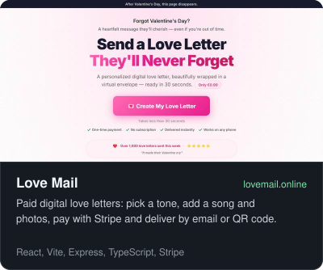</picture></a>
<a href="https://wtechitsolutions.com"><picture><source media="(prefers-color-scheme: dark)" srcset="assets/card-product-wtech-dark.svg"><source media="(prefers-color-scheme: light)" srcset="assets/card-product-wtech-light.svg"></picture></a>
<a href="https://cabinet-flow.com/"><picture><source media="(prefers-color-scheme: dark)" srcset="assets/card-product-cabinetflow-dark.svg"><source media="(prefers-color-scheme: light)" srcset="assets/card-product-cabinetflow-light.svg">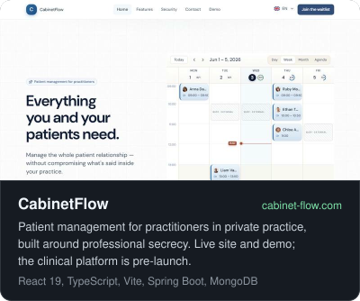</picture></a>

## 🔭 Open-source projects

<a href="https://github.com/LuisEduardoGE/backrooms-game"><picture><source media="(prefers-color-scheme: dark)" srcset="assets/card-repo-backrooms-game-dark.svg"><source media="(prefers-color-scheme: light)" srcset="assets/card-repo-backrooms-game-light.svg">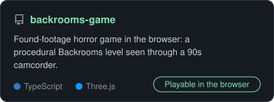</picture></a>
<a href="https://github.com/LuisEduardoGE/rag-docs-assistant"><picture><source media="(prefers-color-scheme: dark)" srcset="assets/card-repo-rag-docs-assistant-dark.svg"><source media="(prefers-color-scheme: light)" srcset="assets/card-repo-rag-docs-assistant-light.svg">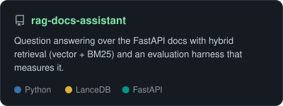</picture></a>
<a href="https://github.com/LuisEduardoGE/fastapi-stripe-webhooks"><picture><source media="(prefers-color-scheme: dark)" srcset="assets/card-repo-fastapi-stripe-webhooks-dark.svg"><source media="(prefers-color-scheme: light)" srcset="assets/card-repo-fastapi-stripe-webhooks-light.svg">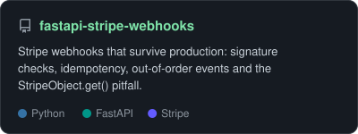</picture></a>
<a href="https://github.com/LuisEduardoGE/movie-helper"><picture><source media="(prefers-color-scheme: dark)" srcset="assets/card-repo-movie-helper-dark.svg"><source media="(prefers-color-scheme: light)" srcset="assets/card-repo-movie-helper-light.svg">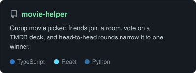</picture></a>
<a href="https://github.com/LuisEduardoGE/primordial"><picture><source media="(prefers-color-scheme: dark)" srcset="assets/card-repo-primordial-dark.svg"><source media="(prefers-color-scheme: light)" srcset="assets/card-repo-primordial-light.svg">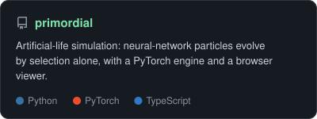</picture></a>
<a href="https://github.com/LuisEduardoGE/marketplace-directory-template"><picture><source media="(prefers-color-scheme: dark)" srcset="assets/card-repo-marketplace-directory-template-dark.svg"><source media="(prefers-color-scheme: light)" srcset="assets/card-repo-marketplace-directory-template-light.svg">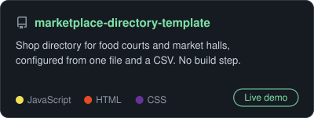</picture></a>
<a href="https://github.com/LuisEduardoGE/fastapi-vs-drf-comparison"><picture><source media="(prefers-color-scheme: dark)" srcset="assets/card-repo-fastapi-vs-drf-comparison-dark.svg"><source media="(prefers-color-scheme: light)" srcset="assets/card-repo-fastapi-vs-drf-comparison-light.svg">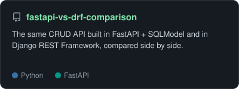</picture></a>
<a href="https://github.com/LuisEduardoGE/planetjersey"><picture><source media="(prefers-color-scheme: dark)" srcset="assets/card-repo-planetjersey-dark.svg"><source media="(prefers-color-scheme: light)" srcset="assets/card-repo-planetjersey-light.svg">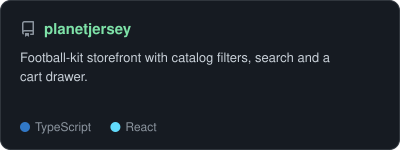</picture></a>
<a href="https://github.com/LuisEduardoGE/qr-code-creator"><picture><source media="(prefers-color-scheme: dark)" srcset="assets/card-repo-qr-code-creator-dark.svg"><source media="(prefers-color-scheme: light)" srcset="assets/card-repo-qr-code-creator-light.svg">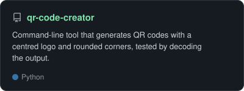</picture></a>
<a href="https://github.com/LuisEduardoGE/bis2-scraper"><picture><source media="(prefers-color-scheme: dark)" srcset="assets/card-repo-bis2-scraper-dark.svg"><source media="(prefers-color-scheme: light)" srcset="assets/card-repo-bis2-scraper-light.svg">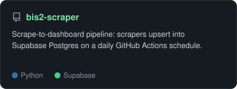</picture></a>

Play **[backrooms-game](https://luiseduardoge.github.io/backrooms-game/)** in your browser, or open the **[marketplace directory demo](https://luiseduardoge.github.io/marketplace-directory-template/)**.

## 🛠 Skills

<picture><source media="(prefers-color-scheme: dark)" srcset="assets/skills-advanced-dark.svg"><source media="(prefers-color-scheme: light)" srcset="assets/skills-advanced-light.svg">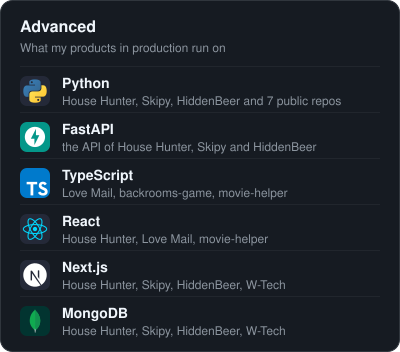</picture>
<picture><source media="(prefers-color-scheme: dark)" srcset="assets/skills-intermediate-dark.svg"><source media="(prefers-color-scheme: light)" srcset="assets/skills-intermediate-light.svg">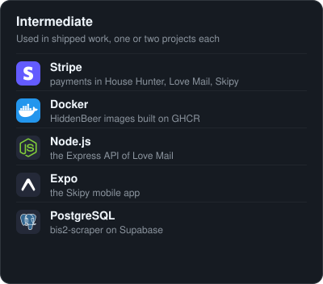</picture>

<b>Full skills list</b> (12 areas)

 

- **Back end:** Python, FastAPI, Pydantic, Flask, Celery, APScheduler, Node.js / Express, REST APIs, WebSockets / Socket.IO, background jobs and scheduling
- **Front end:** TypeScript, JavaScript, React, Next.js (App Router, SSG / SSR), Vite, Tailwind CSS, shadcn/ui, TanStack Query, Three.js, Leaflet maps
- **Mobile:** Expo / React Native, Flutter
- **Databases:** MongoDB (Beanie, geospatial and TTL indexes), PostgreSQL, MySQL, SQLite, Supabase, Redis, LanceDB
- **Scraping and data:** requests, BeautifulSoup, Playwright, pandas, scheduled ingestion pipelines
- **Payments and integrations:** Stripe (Checkout, webhooks, subscriptions), OAuth / Google sign-in, one-time-code login, transactional email (Brevo), Firebase
- **Security:** JWT, OAuth2, HMAC-signed tokens, CSP, rate limiting, SSRF guards, SSH hardening
- **Cloud and DevOps:** Linux VPS (Ubuntu), Docker / Compose, GHCR, nginx, systemd, Let's Encrypt, GitHub Actions, GitHub Pages, Cloudflare
- **Testing:** pytest, Vitest, Playwright, evaluation harnesses for retrieval
- **AI engineering:** retrieval-augmented generation, embeddings, hybrid search, LLM APIs, local models with Ollama, agentic coding workflows (skills, hooks, MCP)
- **CMS:** WordPress, PHP (custom plugins and search)
- **Practices:** Git, code review, CI on every repo, Makefiles, Mermaid architecture docs, SEO (structured data, Search Console)

## 💻 My Tech Stack

<picture>
  <source media="(prefers-color-scheme: dark)" srcset="assets/grid-tech-dark.svg">
  <source media="(prefers-color-scheme: light)" srcset="assets/grid-tech-light.svg">
  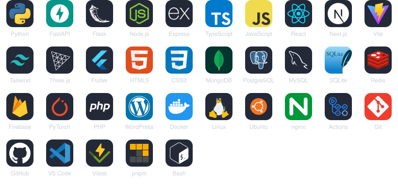
</picture>

## 🤖 AI & LLM Tools

<picture>
  <source media="(prefers-color-scheme: dark)" srcset="assets/grid-ai-dark.svg">
  <source media="(prefers-color-scheme: light)" srcset="assets/grid-ai-light.svg">
  
</picture>

## 🧰 Platforms & Tools

<picture>
  <source media="(prefers-color-scheme: dark)" srcset="assets/grid-platforms-dark.svg">
  <source media="(prefers-color-scheme: light)" srcset="assets/grid-platforms-light.svg">
  
</picture>

## 📊 Activity

<picture>
  <source media="(prefers-color-scheme: dark)" srcset="https://raw.githubusercontent.com/LuisEduardoGE/LuisEduardoGE/output/github-contribution-grid-snake-dark.svg">
  <source media="(prefers-color-scheme: light)" srcset="https://raw.githubusercontent.com/LuisEduardoGE/LuisEduardoGE/output/github-contribution-grid-snake.svg">
  
</picture>

<b>More stats</b> (streak, languages, activity graph)

 

<picture>
  <source media="(prefers-color-scheme: dark)" srcset="https://streak-stats.demolab.com/?user=LuisEduardoGE&theme=dark&background=0d1117&ring=3CB371&fire=3CB371&currStreakLabel=3CB371&hide_border=true">
  
</picture>

## 📫 Get in touch

Hiring for a full-stack or back-end role in the EU or remote? Building a product that needs someone to take it from idea to production? Email me at **[luisedu.ge@gmail.com](mailto:luisedu.ge@gmail.com)**, message me on **[LinkedIn](https://www.linkedin.com/in/luisgespindola/)**, or **[book a 30-minute call](https://calendly.com/luiseduardoge/30min)**.

